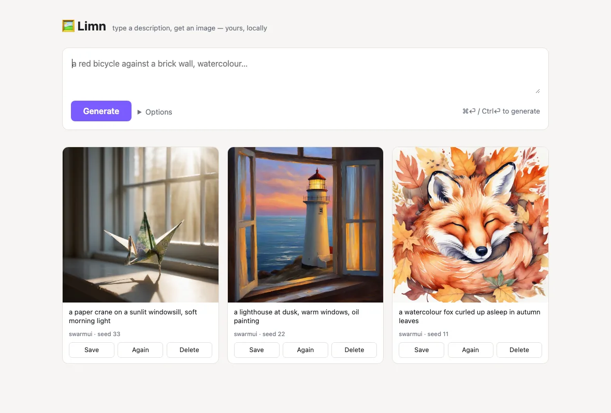

# Limn

> *to **limn**: to depict or describe; to paint.*



A small, privacy-first tool that turns a text description into an image. Type a
prompt, get a picture. No account, minimal options, bring your own provider.

Try the demo at [demo.limn.borck.dev](https://demo.limn.borck.dev), or get the
desktop app for macOS, Windows and Linux at
[limn.borck.dev](https://limn.borck.dev). Prefer the terminal?

```bash
pip install limn

limn "a red bicycle against a brick wall" -o bike.png
```

- Type a description and get an image.
- No account, private by default. Your prompts and images are yours, and the
  only network request goes to the provider you chose.
- Bring your own provider: self-hosted SwarmUI or any OpenAI-compatible
  endpoint, or a cloud key for Google Imagen, OpenAI or DALL·E. Swap it with
  one setting.
- Minimal by design. Prompt, size, count, seed. If you want inpainting,
  ControlNet and node graphs, install something bigger.

## Quick start

Pick whichever provider you already have:

```bash
# Self-hosted SwarmUI (free, your GPU)
export SWARMUI_BASE_URL=https://image.example.org
export SWARMUI_TOKEN=...   # only if fronted by auth
limn "watercolour fox" --provider swarmui

# Any OpenAI-compatible /v1/images endpoint (LocalAI, ...)
export OPENAI_BASE_URL=http://localhost:8080/v1
limn "watercolour fox" --provider openai-compatible

# Google Imagen (cheap, ~$0.02/image on the Fast tier)
export GEMINI_API_KEY=...
limn "watercolour fox" --provider gemini

# OpenAI Images
export OPENAI_API_KEY=...
limn "watercolour fox" --provider openai
```

Then set your provider once so you never pass `--provider` again:

```bash
limn --init-config        # writes a commented ./limn.yaml template
mv limn.yaml ~/.limn.yaml # personal defaults, used everywhere
```

## Usage

```
limn "a red bicycle against a brick wall" -o bike.png
limn "watercolour fox" --provider swarmui --size 1024x1024 --count 4 --seed 42
limn "pixel art, a fox" --lora pixel-art-xl:1.0 --cfg 5 --steps 30
limn --from prompts.txt -M           # batch a prompt list, with metadata sidecars
```

| Option | What |
|---|---|
| `-p, --provider` | `swarmui`, `openai-compatible`, `openai`, `gemini` |
| `-m, --model` | Model name (provider-specific) |
| `-s, --size` | e.g. `1024x1024` (Imagen maps to the nearest aspect ratio) |
| `-n, --count` | Number of images (1-10) |
| `--seed` | Reproducibility, where the backend supports it (SwarmUI) |
| `--negative` | Negative prompt, where supported (SwarmUI) |
| `--lora` | LoRA as `name[:weight]`, repeatable (SwarmUI; unknown names error) |
| `--cfg`, `--steps`, `--sampler`, `--scheduler` | SDXL knobs (SwarmUI; others warn and ignore) |
| `--from` | Read prompts from a file (one per line, `-` for stdin); each auto-named |
| `-M, --metadata` | Write a `<image>.json` sidecar of the generation params |
| `-o, --out` | Output file; default is a slug of the prompt, never overwritten |
| `-c, --config` | Explicit config file |

`limn models` asks your provider which models it offers. SwarmUI requires
picking one, for example `limn "a fox" -m juggernautXL_v9`. The web UI and
desktop Settings have a matching "fetch models" button. `limn models --loras`
lists the server's LoRAs instead (SwarmUI only), with the trigger phrase and
description when the server has that metadata. Many LoRAs only kick in when
their trigger word appears in the prompt.

## Config

Layered, later wins: built-in defaults, then `~/.limn.yaml` (your provider and
keys, set once), then `./limn.yaml`, then CLI flags. Secrets are referenced as
`${VAR}` so no plaintext keys live in files:

```yaml
provider: swarmui
size: [1024, 1024]

providers:            # keep several configured; swap with `provider:`
  swarmui:
    base_url: https://image.example.org
    model: juggernautXL_v9
    api_key: "${SWARMUI_TOKEN}"      # bearer; or use username/password for Basic auth
  swarmui-basic:                     # a second server under its own label
    type: swarmui                    #   which provider class to use
    base_url: https://image2.example.org
    username: admin
    password: "${SWARMUI_PASS}"
  gemini:
    model: imagen-4.0-fast-generate-001
```

SwarmUI auth is auto-detected: `username` plus `password` uses HTTP Basic (for
a reverse proxy in front of SwarmUI); otherwise `api_key` uses Bearer. A
block's `type:` lets you run several servers of the same kind under distinct
labels.

## Web UI

```bash
pip install "limn[serve]"
limn serve                # opens http://127.0.0.1:5466/ in your browser
```

One page: type a prompt, click Generate, and the image appears with Save (to
disk), Again (regenerate) and Delete. The session gallery lives in the server
process's memory only, so nothing touches disk until you click Save.

Binds `127.0.0.1` by default. Binding any other host requires a token
(`--token`, or one is generated and printed); useful flags: `--port`,
`--out-dir`, `--no-browser`.

### Hosting a shared demo

A live instance runs at [demo.limn.borck.dev](https://demo.limn.borck.dev).
`limn serve --demo` (or `LIMN_DEMO=1`) runs a public instance with guardrails
instead of a token:

- 10 images per hour per IP
- provider and model locked to the server config
- one image per request, max 1024px
- server-side Save disabled, so visitors download instead
- gallery entries expire after 15 minutes
- a banner explaining the demo and how to install

See [docs/demo-deploy.md](docs/demo-deploy.md).

## Desktop app

A native app (Tauri) for people who don't live in a terminal. Install it, pick
your provider in Settings (server URL and API key), then type and generate.
First launch bootstraps a private Python runtime via `uv` (about a minute, no
system Python needed); images save to `Pictures/Limn`. Installers for macOS,
Windows and Linux are built by CI from [`desktop/`](desktop/) and published at
[limn.borck.dev](https://limn.borck.dev) (or the
[GitHub releases page](https://github.com/michael-borck/limn/releases)). macOS
builds are code signed and notarized; Windows builds are unsigned ("More info,
then Run anyway").

## Roadmap

The CLI, web UI (`limn serve`), demo mode and desktop app are all in place. See
[SPEC.md](SPEC.md) for the full specification.

Companion to [slide-stream](https://github.com/michael-borck/slide-stream),
which shares the same image-provider approach.